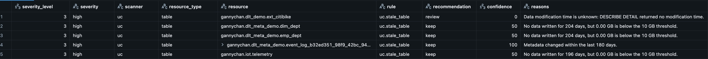
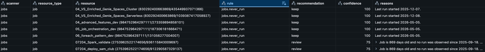

# Lakehouse Governance & Cost

[](https://github.com/gchandra10/lakehouse-gc/actions/workflows/ci.yml)
[](https://github.com/gchandra10/lakehouse-gc/actions/workflows/security.yml)

-brightgreen)
-brightgreen)
[](LICENSE)

**lakehouse-gc** is a read-only Python package that checks your Databricks lakehouse for
governance gaps and cost waste. It explains every result, and it never changes anything.

[](docs/uc-scan-output.jpg)

[](docs/jobs-scan-output.jpg)

*Click an image to enlarge it.*

**Questions?** See the [FAQ](docs/FAQ.md): short answers for data teams and for security
and governance teams.

## Learn more

- **[Examples](docs/EXAMPLES.md):** nine notebooks from easy to advanced, covering
  restricted access, custom checks, policy in code, and more.
- **[Details](docs/DETAILS.md):** installation, rules, scoring, policy reference, and
  architecture.

## What it does

- **Scans Unity Catalog:** checks the catalogs, schemas, and tables you choose in a simple
  `policy.yaml`.
- **Checks governance:** finds missing owners, missing descriptions, missing required tags,
  temporary-looking names, and empty catalogs or schemas.
- **Checks Lakeflow Jobs:** finds jobs with no observed run and jobs whose every run has
  failed for several days in a row.
- **Checks cost:** finds large tables with no recent data writes.
- **Scores your estate:** gives a Governance, Cost, and Overall score from 0 to 100, plus a
  grade, with an audit trail of what cost points.
- **Explains itself:** every finding includes reasons, evidence, and a confidence level.
  `rules_dataframe()` shows what each rule means and the settings your policy applies.
- **Stays honest:** missing data is reported as *unknown*, never guessed. Inactivity is
  never treated as proof that something is unused.
- **Works with restricted access:** `check_access()` shows what you can read before
  scanning. If the `system` catalog is blocked, or your org publishes its own views, point
  the scanner at them in `policy.yaml`.
- **Stays safe:** report-only. It recommends `keep`, `review`, `tag_owner`, and similar,
  but never deletes, pauses, or modifies anything.
- **Is extensible:** you can add your own checks with a few plain Python functions.

## Usage

In a Databricks notebook, after installing the wheel:

```python
from lakehouse_gc import check_access, rules_dataframe, run

POLICY_PATH = "/Volumes/main/default/lakehouse_gc/policy.yaml"

print(check_access(spark, POLICY_PATH, scanners=["uc"]).summary())  # what can I read?
display(rules_dataframe(spark, POLICY_PATH, scanners=["uc"]))  # what will be checked

result = run(POLICY_PATH, scanners=["uc"], spark=spark)
print(result.summary())  # scores, grade, counts
display(result.to_dataframe(spark))  # one row per finding, most severe first
# Optional: result.save(spark, table="main.governance.findings") or json_path="/Volumes/..."
```

Choose what to scan in `policy.yaml`:

```yaml
policy_version: 1
scope:
  include_catalogs: ["main"]
  include_schemas: ["main.sales"]
exclusions:
  - resource_type: table
    pattern: "main.sales.archive_*"
    reason: "Retention policy"
    expires_on: null
rules:
  uc:
    stale_table_days: 180
    required_tags: ["cost_center"]
```

Start from [`examples/policy.yaml`](examples/policy.yaml), which documents every key.

Example output:

```text
Run 3f9c...: succeeded (uc)
  Governance: 68.83  (43 checks, 100% with known evidence)
  Cost: 70  (5 checks, 80% with known evidence)
  Overall: 69.42  grade: D
  Findings: excluded=1, keep=34, review=8, tag_owner=6
```

## Security and trust

- **Read-only by design:** only `SELECT`, `SHOW CATALOGS`, and `DESCRIBE DETAIL` are run,
  and no policy setting can enable changes.
- **One runtime dependency:** PyYAML.
- **Audited:** [`pip-audit`](https://github.com/pypa/pip-audit) (Python Packaging
  Authority) checks every locked dependency against the [OSV](https://osv.dev)
  vulnerability database. It runs weekly, on every dependency change, and before every
  release; a release can't be published while a known vulnerability exists. The
  **Security audit** badge above shows the latest result.
- **Verifiable releases:** each release ships `SHA256SUMS.txt`, a CycloneDX SBOM for your
  own scanners, and a signed build provenance attestation
  (`gh attestation verify <wheel> --repo gchandra10/lakehouse-gc`).
- **Found a problem?** See [SECURITY.md](SECURITY.md) to report it privately.

## License

Source-available under the [Databricks License](LICENSE). See [NOTICE](NOTICE).
